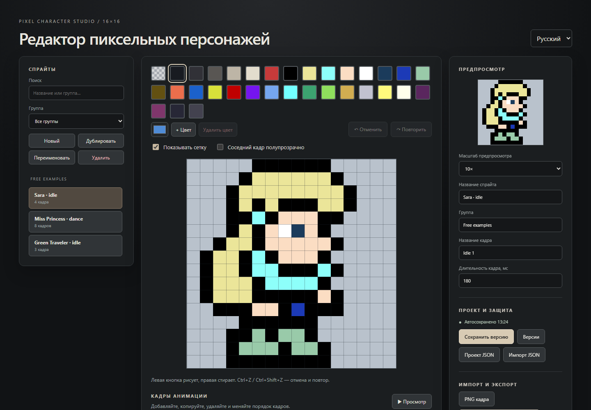

# Pixel Character Studio

[English](README.md) · [Русский](README.ru.md) · [Español](README.es.md) · [中文](README.zh-CN.md)

Editor independiente para navegador destinado a dibujar personajes pixel art de 16×16 y crear animaciones fotograma a fotograma. Funciona localmente, no requiere cuenta ni servidor y no está vinculado a ningún juego.



## Funciones

- editor de 16×16 con cuadrícula, borrador, deshacer y rehacer
- creación, duplicación, eliminación y reordenación de sprites y fotogramas
- duración ajustable y vista previa a 1×, 2×, 4×, 8× o 10×
- visualización semitransparente del fotograma anterior
- paleta integrada y colores personalizados
- búsqueda y agrupación de sprites
- guardado local automático y hasta cinco versiones manuales
- importación y exportación del proyecto en JSON
- importación de PNG 16×16 y exportación del fotograma actual en PNG
- exportación ZIP del spritesheet con PNG y atlas JSON
- interfaz en inglés, español, ruso y chino simplificado
- tres ejemplos editables de animación de personajes

## Uso local

No hace falta compilar. Descarga el repositorio y abre `index.html` en un navegador moderno.

También puedes iniciar un servidor local desde la carpeta del proyecto:

```bash
python -m http.server 8000
```

```bash
npx serve .
```

Después abre `http://localhost:8000` o la dirección mostrada por el servidor.

## Publicación con GitHub Pages

1. Sube el proyecto a GitHub.
2. Abre **Settings → Pages** en el repositorio.
3. Selecciona **Deploy from a branch**.
4. Elige la rama `main` y la carpeta `/ (root)`.

Los proyectos se guardan en el `localStorage` del navegador. Exporta el proyecto como JSON para moverlo entre navegadores u ordenadores.

## Ejemplos de terceros

Los autores y las condiciones de los ejemplos incluidos se indican en [THIRD_PARTY_ASSETS.md](THIRD_PARTY_ASSETS.md).

## Licencia del proyecto

Todavía no se ha elegido una licencia para el código fuente del editor. Añade un archivo `LICENSE` antes de aceptar colaboradores externos o conceder derechos de reutilización.
